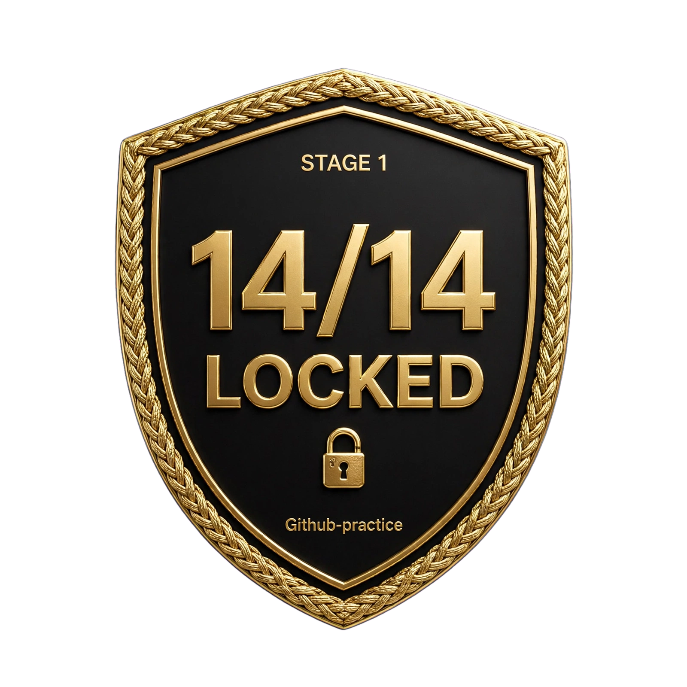

# Github-practice - 100 Days of Code
## STAGE 1: 14/14 LOCKED 🔒

**Trust Chain:** `6d04dac..e8d1a8f` -> `week2-http` - `Total 5 (delta 3)` verified
**Auth:** `gh auth git-credential` | `https` | `escorpioantares66-cmyk`
**Ledger:** `stage1-basics/CHANGELOG.md`

### Streak
- [x] Day 8: Real Async HTTP + Professional Refactor
- [x] Day 9: Resilient Client + Mypy Fix (BaseException)
- [x] Day 10: Concurrency Control Semaphore(3)
- [x] Day 11: Caching + Idempotency (TTLCache + coalescing)
- [x] Day 12: Persistent Cache + Metrics
- [x] Day 13: Circuit Breaker + Retry
- [x] Day 14: Final HTTP Client + Secure gh HTTPS Push - **STAGE 1 COMPLETE** (72a3358..e8d1a8f, 7+5 objects, 1.98 KiB + 1.75 KiB)
