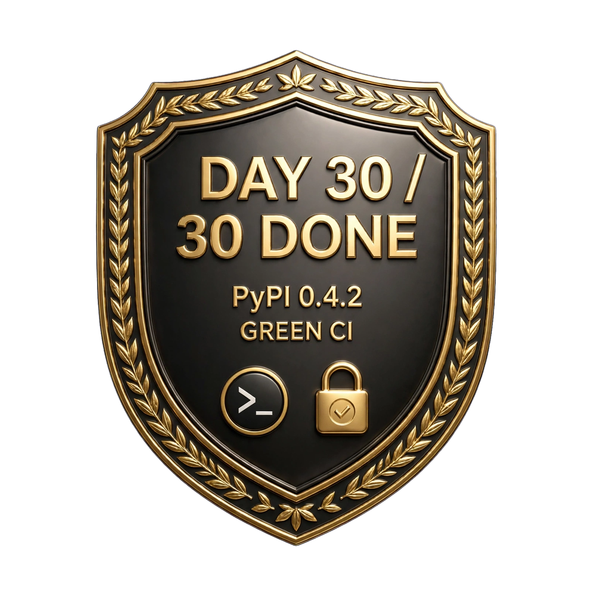

# github-practice

[](https://github.com/escorpioantares66-cmyk/Github-practice/actions/workflows/ci.yml)

A production-ready Python SDK + CLI for JSONPlaceholder Users API. Built mobile-first on Termux.

## Install
pip install github-practice

## CLI Usage
practice-cli --id 1
practice-cli --id 1 --json
practice-cli --search Leanne

## SDK Usage
from stage2_sdk import get_user, get_users, search_users
user = get_user(1)
print(user.name)

## Dev
pip install -e .
pytest -v
ruff check .

---

## Day 30 Retrospective — From `delta 0` to PyPI 0.4.2 📦



**Built mobile-first on Termux. No laptop. No IDE.**

### The Journey
- **Stage 1: 14/14 LOCKED 🔒** — `Week2 Day8-14`
    - Real `httpx.AsyncClient`, `AppConfig(frozen=True, slots=True)`, `httpx.Timeout(10.0)`, `str(url)` explicit
    - Resilient client: `ApiError / AuthError / NotFoundError / ServerError`, retry with `2**attempt + random.uniform(0,0.5)`
    - Mypy fix: `BaseException` not `Exception` for `gather(return_exceptions=True)`
    - Concurrency: `Semaphore(3)` — 6 delayed requests in 5.73s not 25s serial
    - Cache: `TTLCache` + `_PENDING` coalescing + `CacheMetrics` + disk persistence
    - Auth war: SSH 22 blocked, HTTPS 443 blocked on carrier — fixed with `gh auth git-credential`
    - Trust Ledger Rule: No day DONE without `Total X (delta Y)` where `delta > 0`

- **Stage 2: SDK + CLI + Ship (Day 15-30)**
    - `stage2_sdk` + `stage3_cli` package init — `pip install -e .`
    - `LICENSE`, `CHANGELOG`, `USAGE` docs, `practice-cli` entry point
    - Package: `github-practice` on PyPI — `pip install github-practice`

### The Final Boss — Day 29-30
**The red badge.**

My 0.4.1 page on PyPI showed: `ci failing`.

Screenshot said: `ModuleNotFoundError: No module named 'stage2_sdk'` — `Process completed with exit code 2.`

Root cause: `.github/workflows/ci.yml` was doing:
```yaml
- run: pip install requests pytest ruff
- run: pip install -e . requests pytest ruff bleach
- run: ruff check . || true
